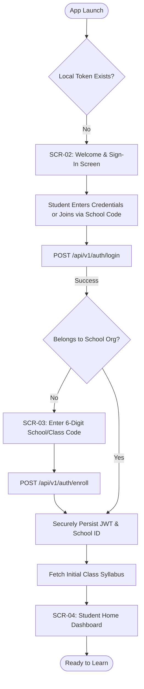
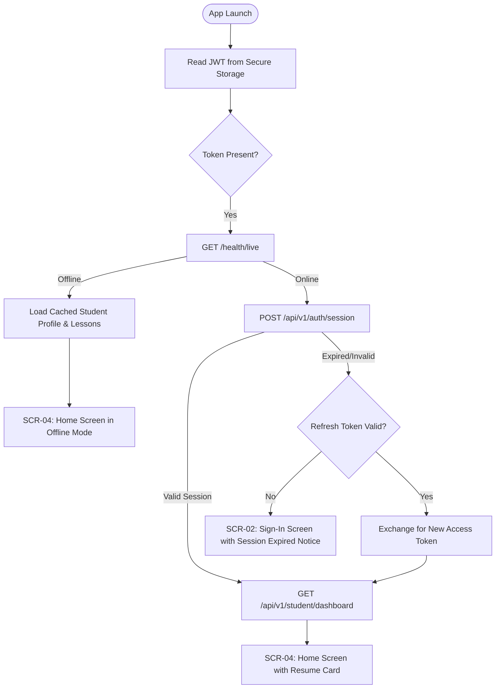
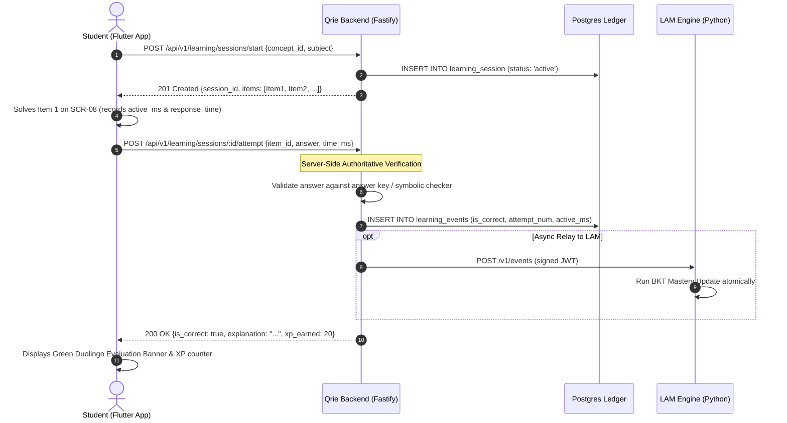
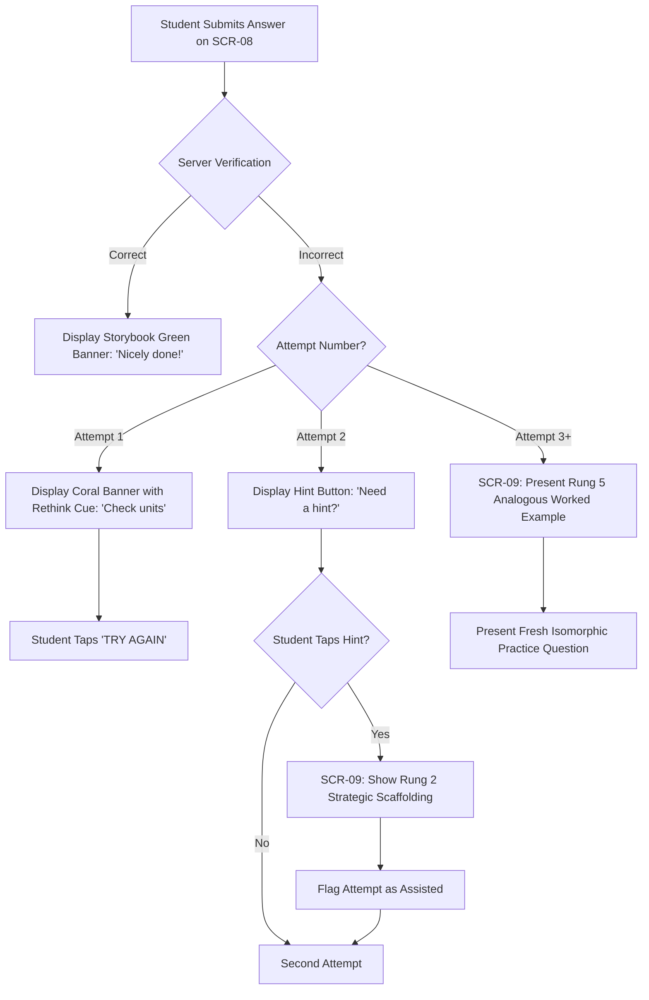
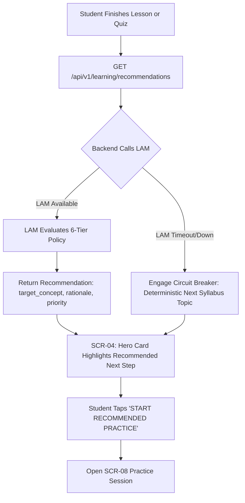
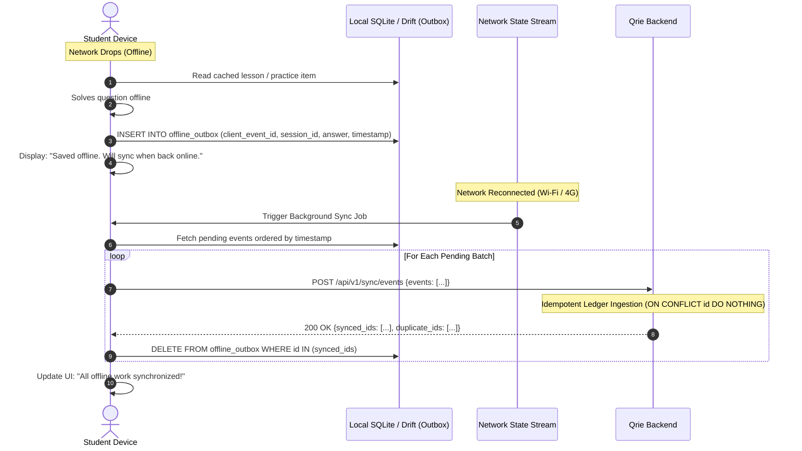
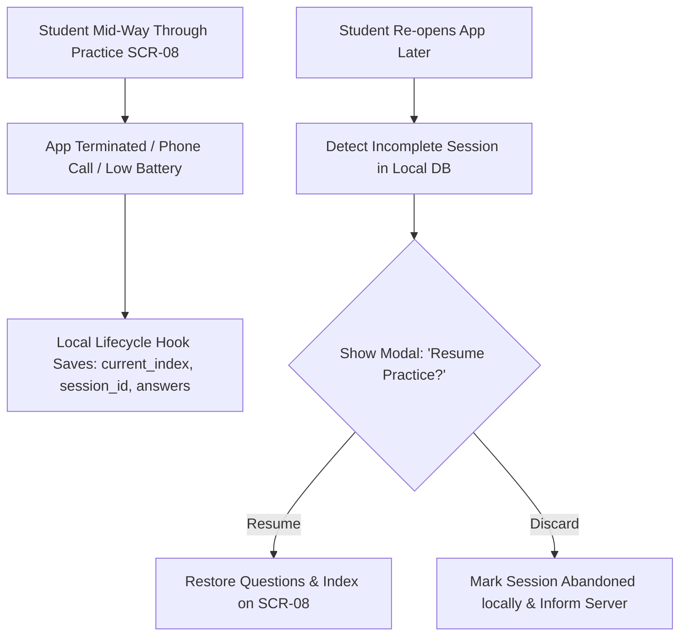
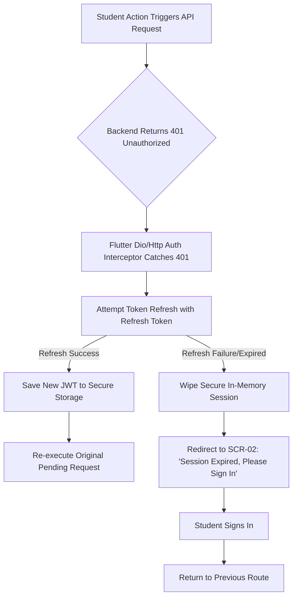

# Qrie Student App — User Journeys & Flowcharts

**Document Reference:** `docs/student-app/USER_JOURNEYS.md`  
**Status:** Approved Specification  
**Author:** Principal UX Architect & Flow Designer  

---

## Journey A: First-Time Student Onboarding & Enrollment

---

## Journey B: Returning Student Session Resume

---

## Journey C: Independent Curriculum Practice & Verification

---

## Journey D: Incorrect Answer & Adaptive Assistance Escalation

---

## Journey E: Adaptive Recommendation & Next Activity

---

## Journey F: Offline Mode, Durable Outbox & Reconnect Sync

---

## Journey G: Session Interruption & Crash Recovery

---

## Journey H: Session Expiry & Safe Re-Authentication

